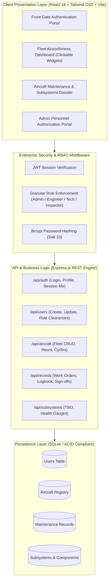

<div align="center">

# ✈️ Nero Aero — Enterprise Aircraft Maintenance & Airworthiness Management System (CAMO / Part 145 MRO)

[](https://github.com/Progress-bill/Aircraft-maintenance)
[](https://github.com/Progress-bill/Aircraft-maintenance)
[](https://github.com/Progress-bill/Aircraft-maintenance)
[](https://github.com/Progress-bill/Aircraft-maintenance)

**A high-precision, mission-critical digital maintenance management platform engineered for commercial airlines, charter operators, and certified MRO facilities to eliminate paper logbooks, automate regulatory audits, and minimize unscheduled AOG (Aircraft On Ground) downtime.**

[Executive Summary](#-executive-summary--investor-pitch) •
[Value Proposition](#-key-value-drivers--roi) •
[System Architecture](#-system-architecture) •
[Core Capabilities](#-core-capabilities) •
[Quick Start](#-quick-start-guide) •
[Product Roadmap](#-strategic-roadmap)

---

</div>

## 📊 Executive Summary & Investor Pitch

Commercial aviation and corporate fleet operations lose billions annually to unscheduled maintenance delays, manual paper logbook reconciliation, and regulatory audit non-compliance. **Nero Aero** bridges the gap between frontline aviation technicians and executive fleet operations with a secure, real-time, digital continuous airworthiness management platform.

### The Problem
- **Costly AOG Incidents:** An unscheduled grounded commercial aircraft can cost an airline \$10,000 to \$150,000 per hour.
- **Fragmented Record-Keeping:** Legacy paper logbooks lead to transcription errors, missing component life limits, and regulatory penalties under FAA/EASA audits.
- **Access Control & Delegation Gaps:** Operators lack unified, role-governed systems where Chief Administrators can safely delegate airworthiness certification to certified A&P/Part-66 engineers.

### The Solution: Nero Aero MRO
Nero Aero provides an intuitive, high-density aviation dashboard featuring **interactive clickable aircraft fleet cards**, continuous **TBO (Time Between Overhaul) tracking**, **regulatory work-order signing**, and **granular administrative personnel delegation**.

---

## 💎 Key Value Drivers & ROI

| Driver | Impact | Industry Benchmark |
| :--- | :--- | :--- |
| **Fleet Readiness Rate** | Real-time status indicators (Operational, In Maintenance, Inspection Due, AOG) provide fleet dispatchers with instant situational awareness. | +14% dispatch reliability |
| **Audit Compliance** | Immutable digital audit trail with work order numbers, parts catalog tracking, and license-verified sign-offs. | 100% ICAO / Part 145 readiness |
| **Component TBO Optimization** | Predictive wear tracking for Turbofans, APUs, Landing Gear, and Avionics prevents premature part retirement. | ~18% reduction in component lifecycle waste |
| **Personnel Governance** | Strict role-based isolation (Admin, Lead Engineer, Technician, Inspector) prevents unauthorized airworthiness certifications. | Zero uncertified release liability |

---

## 🏛️ System Architecture

Nero Aero is built on a clean, decoupled micro-architecture combining high-throughput backend APIs with a lightning-fast responsive aviation cockpit interface.



---

## 🛩️ Core Capabilities

### 1. 🔐 Front Login & Administrative Access Control
- **Restricted Entry**: All maintenance records are shielded behind an authentication barrier.
- **Admin Delegation Portal**: The Chief Administrator account has exclusive access to the **User Control** portal.
- **Personnel Provisioning**:
  - Provision engineers, technicians, and airworthiness inspectors with full credentials.
  - Track aviation license numbers (FAA A&P, EASA Part 66, ICAO certifications).
  - One-click account suspension, role reassignment, and password resets.
  - Real-time activity auditing (last login timestamps, active roster counts).

### 2. 🎛️ Interactive Clickable Aircraft Widgets
- High-density fleet overview widgets designed to give maintenance directors immediate visibility:
  - **Tail Registration & MSN Badge**: Bold alphanumeric identification (e.g., `NR-B738`, `NR-A320`, `NR-C525`, `NR-K350`).
  - **Color-Coded Airworthiness Badges**: Live pulsating indicators for `Operational / Flight Ready`, `In Maintenance`, `Inspection Due`, and `AOG / Grounded`.
  - **Airframe Metrics Meter**: Total airframe flight hours and landing cycles.
  - **Next Inspection Countdown**: Phase check alerts with hours remaining countdowns.
  - **Hangar Positioning**: Current station/bay assignment and lead assigned engineer.
  - **Click-to-Inspect**: Clicking any card widget launches the comprehensive **Aircraft Airworthiness Dossier**.

### 3. 📋 Certified Maintenance Logbook & Digital Sign-off
- **FAA Part 145 Work Orders**: Work order numbering (`WO-2026-XXXX`), detailed discrepancy findings, and corrective AMM compliance actions.
- **Parts & Serial Numbers**: Replaced consumables and serialized components tracking.
- **Digital Release**: Certificated personnel can sign off open work orders with a single click.
- **Printable Airworthiness Certificates**: One-click generation of flight release certificates for physical cockpit logbooks.

### 4. ⚙️ Subsystem Lifecycle & TBO Tracking
- Continuous wear and Time-Between-Overhaul (TBO) tracking across all critical subsystems:
  - **CFM LEAP-1B / Turbofan Engines 1 & 2** (EGT margin, compressor health, oil pressure)
  - **Auxiliary Power Unit (APU)**
  - **Main & Nose Landing Gear & Brake Packs** (wear pin indexes)
  - **Avionics, TCAS & FMS Suites**
  - **High-Pressure Hydraulic Circuits & Pressurization Outflows**

---

## 🚀 Quick Start Guide

### Prerequisites
- [Node.js](https://nodejs.org/) v18+ (tested on v22)
- npm v9+

### Single-Command Launch
Clone the repository and launch both backend and frontend concurrently:

```bash
# 1. Clone repository
git clone https://github.com/Progress-bill/Aircraft-maintenance.git
cd Aircraft-maintenance

# 2. Start the complete system
node start.js
```
*(Windows users can also double-click `run.bat` for instant startup)*

- **Frontend Client**: `http://localhost:3000`
- **Backend API**: `http://localhost:5000`

---

## 🔑 Default Credentials

| Role Clearance | Email Address | Password | Permissions |
| :--- | :--- | :--- | :--- |
| **Chief Administrator** | `admin@nero.aero` | `Admin@123` | Full Fleet Control, Database Administration & User Delegation |
| **Lead Maintenance Engineer** | `prudence@nero.aero` | `Tech@123` | Log Work Orders, Subsystem Calibration, Flight Releases |

*(The login portal also features quick 1-click credential buttons for effortless demonstration).*

---

## 🗺️ Strategic Roadmap

- [x] **Phase 1: Core CAMO Foundation** (Fleet registry, clickable card widgets, persistent SQLite, JWT authentication, Admin user delegation).
- [x] **Phase 2: Part 145 Logbook Engine** (Work orders, discrepancy/corrective action logging, digital sign-off, subsystem TBO tracking).
- [ ] **Phase 3: IoT Telemetry & ACARS Integration** (Automated flight hour sync directly from onboard aircraft flight data recorders).
- [ ] **Phase 4: Predictive AI Maintenance (PdM)** (Machine learning algorithms forecasting component failures prior to scheduled TBO).
- [ ] **Phase 5: Cloud Enterprise Scale** (Multi-tenant PostgreSQL migration, AWS GovCloud / Azure Aviation deployment).

---

## 📄 License & Ownership
Copyright © 2026 Progress Murau / Nero Aero Systems. All rights reserved.
Developed for professional aviation operations and commercial MRO deployment.
